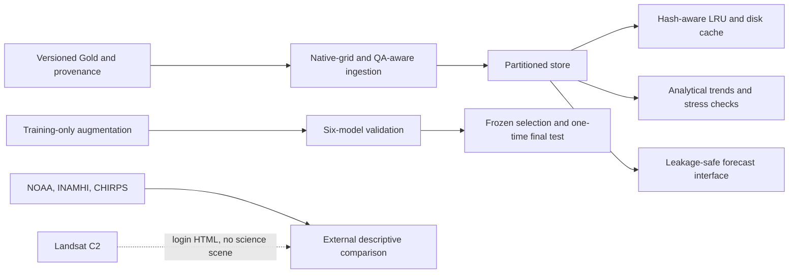

# KUNTUR Earth Observation Engines

KUNTUR Competition v1.0 is a reproducible, research-stage toolkit for quality-aware analysis and one-month regional temperature forecasting from NASA Earth observation products. The released source contains the processing and evaluation code, synthetic-fixture tests, protocols, and compact aggregate evidence. It does not contain NASA granules, derived monthly observations, station records, credentials, or private HPC paths.

## Scientific scope

The verified inputs are the frozen 2002–2024 Ecuador pilot bounding-box Gold table and its +1-month MERRA-2 temperature forecasting table. The geography is the preliminary rectangle `[-81.5, -5.1, -75.0, 1.7]` in EPSG:4326; it is not an administrative boundary or a Coast, Andes, Amazon, watershed, or external-comparison mask. All source collections retain their native grids. Analysis outputs are descriptive; trend estimates are not causal claims. The six-model internal robustness set is a development diagnostic, not external validation.

## Architecture



## Results and protocols

- [Phase 2 handoff and exact local artifact hashes](reports/phase2/PHASE2_HANDOFF_v1.md)
- [Frozen scientific contract](configs/data_contract_v1.json)
- [Variable dictionary](docs/data_dictionary_v1.csv)
- [Forecast and augmentation protocol](docs/protocols/predictive_model_protocol_v1.md)
- [External comparison protocol](docs/protocols/external_validation_protocol_v1.md)
- [Downstream Python interface](docs/phase2_api.md)
- [Benchmark and external comparison tables](results/phase2/public/)

The final test selected histogram gradient boosting using the untouched validation set, then evaluated the frozen model once on 36 months from 2022–2024. Results and the disclosed process-access caveat are in the handoff. Model intervals had 55.6% empirical coverage against a nominal 90% target and must not be treated as calibrated guarantees. Internal stress tests use 38 unique chronological months; the many perturbed records do not increase the number of independent months.

## Installation and tests

Use Python 3.12 in an isolated environment:

```powershell
python -m venv .venv
.\.venv\Scripts\Activate.ps1
python -m pip install --upgrade pip
python -m pip install -e ".[phase2,test]"
python -m pytest -q
```

To run the authenticated, resumable external-source acquisition adapters, install the separate `external` extra and follow the source terms. INAMHI yearbook tables and external observations are not redistributed by this repository. CHIRPS crops and all source data remain in local ignored storage.

The summary artifacts in `results/phase2/public/` were computed from the frozen local Gold and manifests. A local rerun requires those inputs, which are delivered separately through the project’s restricted data handoff; it must not redownload or replace the frozen v1 files. `scripts/verify_phase2_release.py` checks local hashes and the frozen-input invariants when data are present.

## Provenance and source references

NASA inputs and original acquisition checksums are described in the local handoff and manifests. External sources used for evaluation are NOAA/NCEI GHCN-M v4 QCU, public INAMHI yearbook tables (2002–2012 found), and CHIRPS v3 final monthly. CHIRPS blends satellite and station information, including overlapping station sources, so it is cross-product corroboration rather than independent ground truth. The bounded Landsat Collection 2 STAC asset request returned a 200 HTML login page instead of a scientific raster; no Landsat measurement was evaluated.

- [NOAA GHCN-M v4 readme](https://www.ncei.noaa.gov/pub/data/ghcn/v4/readme.txt)
- [INAMHI yearbook landing page](https://servicios.inamhi.gob.ec/anuarios/)
- [CHIRPS v3 data page](https://www.chc.ucsb.edu/data/chirps3) and [product README](https://data.chc.ucsb.edu/products/CHIRPS/v3.0/README-CHIRPSv3.0.txt)
- [USGS Landsat Collection 2 cloud access](https://www.usgs.gov/landsat-missions/landsat-commercial-cloud-data-access)

## Security, data use, and license

The repository is private. Git excludes raw data, derivatives, cache files, logs, runtime models, credentials, and machine-specific acquisition configuration. Gitleaks scans pushes and pull requests. No license is granted pending contributor ownership and third-party data-license review; see [LICENSE](LICENSE).

The observed source data are not bundled. Follow the providers’ terms and the institution’s access and storage policies when using them. Coast/Andes/Amazon and external-comparison regional masks remain pending approved geographic definitions.

## Citation

See [CITATION.cff](CITATION.cff). Version 1.0.0 identifies the code and aggregate results; it does not include or license the underlying satellite or station observations.
